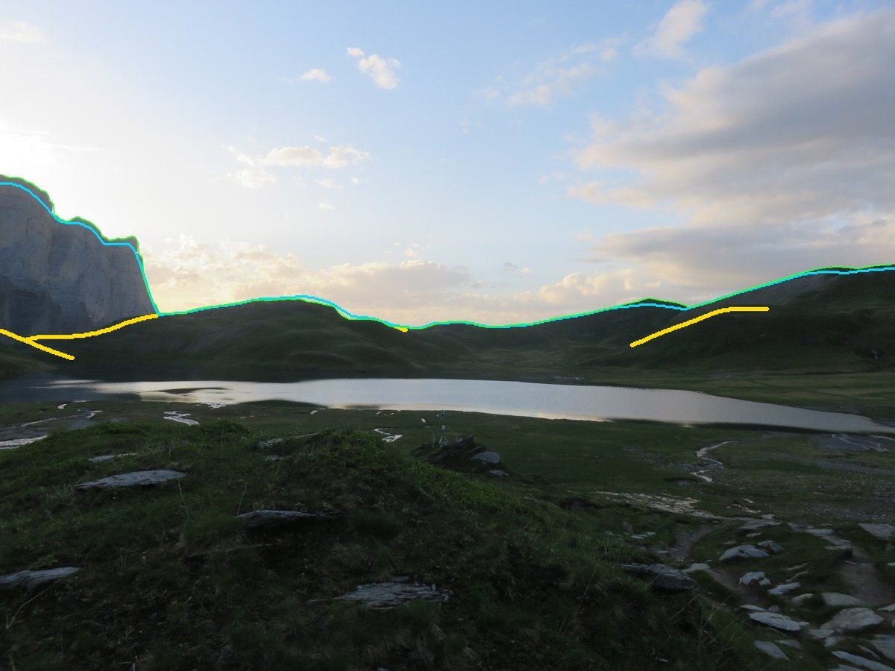

# Crestline

*In French: S.D.E.C.E. : Système de Détection de l'Emplacement par Comparaison des Escarpements — nom pris au hasard.*

**Find where a mountain photo was taken, without GPS, from its skyline.**

[Version française](README_FR.md)



*Photo of Lac d'Anterne (French Alps). Crestline finds its position and heading (343°) among 230,000 candidate
viewpoints. In cyan: the skyline rendered from the terrain model at the found location.*

## The story

I have had this project in mind since 2021. The line of the ridges against the sky is a fingerprint: seen from a
given spot, it is unique. Compare it with the skylines computed from a terrain model everywhere, and you should be
able to tell where a photo was taken.

I never got around to it. A literature review, a training set, a neural network, a GPU terrain renderer and a
search engine add up to months of work for a side project. It was not worth it.

In 2026 I built it with [Claude Code](https://claude.com/claude-code) in a few days:

- the literature review;
- labels generated from photos that volunteers had aligned on a 3D model;
- training and publishing the model;
- a skyline database covering all of Switzerland;
- the search index;
- the evaluations;
- this package.

What was not worth building became worth it.

## Try it now

```bash
pip install git+https://github.com/ExtReMLapin/crestline
crestline demo
```

The demo takes a few minutes on an NVIDIA GPU:

1. it downloads part of the Swiss terrain model (a few hundred MB);
2. it builds a 60 × 60 km map around Mont Blanc;
3. it finds where the Lac d'Anterne photo was taken.

Install the [right torch build for your GPU](https://pytorch.org/get-started/locally/) first; RTX 50xx cards
need CUDA ≥ 12.8. The command-line messages are in French for now.

### A photo from the web, in one command (Matterhorn, Switzerland)

```bash
crestline locate https://upload.wikimedia.org/wikipedia/commons/b/bd/Weissgrat_from_Gornergrat_2021_04.jpg --near "Gornergrat" --radius 10
```

```
Gornergrat : Gornergrat, Zermatt, Visp, Valais (45.9833, 7.7850), rayon 10 km
source du relief : swisstopo
zone 20 × 20 km, 26 k points de vue : téléchargement ~0.1 Go, disque ~0.3 Go, mémoire GPU ~0.4 Go, ~1 min
...
Weissgrat_from_Gornergrat_2021_04.jpg : position GPS trouvée dans l'EXIF (45.98335, 7.78503). Elle n'est pas
utilisée pour chercher, on lance quand même ; l'écart sera affiché à la fin.
Weissgrat_from_Gornergrat_2021_04.jpg : 45.98347, 7.78520  cap 97°  score 0.106°  confiance élevée
  OSM    : https://www.openstreetmap.org/?mlat=45.98347...
  écart avec le GPS de l'EXIF : 19 m
```

Here is what happens, in about 1 minute the first time and a few seconds after that:

1. `--near` finds the area through OpenStreetMap.
2. The most accurate terrain model available is picked automatically: IGN in France, swisstopo in Switzerland.
3. The map is built, then cached.
4. The focal length is read from the image EXIF.

The result lands **19 m** from the photo's GPS position. Crestline does not use that position: it only reports the
error at the end. Photo: Wikimedia Commons, CC BY-SA 4.0.

### Build a map once, use it for many photos

```bash
crestline map build maps/zermatt --near "Zermatt" --radius 12 --index
crestline map build maps/anterne --source ign --bbox 6.70,45.93,6.90,46.05 --index
crestline locate https://raw.githubusercontent.com/ExtReMLapin/crestline/main/crestline/demo/lac_anterne.jpg --map maps/anterne
```

The IGN terrain model (RGE ALTI, lidar, 5 m) is downloaded tile by tile from the French Géoplateforme. An
interrupted download resumes where it stopped.

- **Estimate before running**: before any large job, Crestline shows the estimated download size, disk space, GPU memory and time, then asks for confirmation (`--yes` skips it).
- **Negative longitudes** (Pyrenees, western France): write `--bbox=-0.30,42.62,0.02,42.86`, otherwise the `-` is read as an option.

### Your photos

```bash
crestline locate photo.jpg --map maps/anterne
crestline locate my_photos/ --map maps/anterne --out results/
crestline locate https://example.org/photo.jpg --map maps/anterne --fov 65   # no focal length in EXIF
```

## Terrain sources

**Terrain accuracy matters more than anything else.** A 30 m error on a ridge 1 km away shifts it by ~1.7°, while
the matching works at ~0.15°.

`--source auto` (the default with `--near`) picks one for you.

| `--source` | Coverage | Accuracy | Licence | Advice |
|---|---|---|---|---|
| `ign` | France | lidar, 5 m (1 m available) | Licence Ouverte Etalab 2.0 | **best in France** |
| `swisstopo` | Switzerland + ~100 km around | 10 m (2 m in Switzerland) | free, "© swisstopo" | **best in Switzerland** |
| `copernicus` | worldwide | radar, 30 m | free (ESA) | fallback: ~68 % success instead of 88 % |

- **What gets downloaded**: the viewpoint area + 30 km at the fine cell size (nearby terrain), and the area + 120 km at 80 m (distant horizon).
- **Gaps** are filled by the next source (`ign` → `swisstopo` → `copernicus`), and the provenance is recorded in the map.
- **Polite networking**: each installation identifies itself to the services with a random ID (`~/.config/crestline/install_id`, which reveals nothing about the machine). Geocoding follows the OpenStreetMap policy (1 request per second), and results are cached.
- **Nothing is done twice.** Running the same command again reuses the downloaded terrain, the skylines and the index (same source, same cell size, area contained in the previous one). If a setting changes (step, camera height, area), only the map is rebuilt. `--force` redoes everything.
- **Just download the terrain**: `crestline dem fetch --source ign --bbox … --out folder/`.
- **Your own terrain model** (GeoTIFF, any coordinate system): `--dem my_dem.tif` instead of `--source`.

## Usage

### Two search modes

```
 BRUTE MODE                                  INDEX MODE
 ──────────                                  ──────────
 map build                                   map build --index  (or: map index MAP)
 compares the photo with EVERY viewpoint     the index proposes ~1,000 places, matched exactly
 + nothing else to build                     + ~0.1 s per photo, almost independent of the area
 - cost grows with the area                  - misses the right answer ~5 % of the time
 → small areas                               → regions or countries
```

By default (`--mode auto`), the index is used when it exists.

### Speed and GPU memory

Measured on one RTX 5090 with a map of all of Switzerland (5 million viewpoints):

- **Locating a photo** takes ~0.09 s in index mode (version 0.1: ~1.5 s on one GPU, ~1 s on three).
- **Building a map** computes ~25,000 viewpoints per second: the demo map (230,000 viewpoints) takes ~10 s
  instead of ~1 min.
- **GPU memory**: the terrain model goes on the GPU first. The index (4.6 GB for Switzerland) and, in brute mode,
  the skylines follow piece by piece as long as there is room; the rest stays in RAM, slower but working.
- The two heavy computations (ray casting, index votes) run as [Triton](https://triton-lang.org) GPU kernels. Without
  Triton (CPU, macOS, Windows), or with `CRESTLINE_NO_TRITON=1`, the plain PyTorch version is used.

### Output

By default, results go to `crestline_out/<timestamp>_<photo>/`; choose another folder with `--out`.

```
result.json        top 5: lat/lon, heading, pitch, roll, score, confidence, OpenStreetMap / Google Maps links
result.geojson     points + viewing direction (geojson.io, QGIS)
summary.md         human-readable summary
skyline.jpg        detected skyline: green = used, red = ignored (cloud edge...)
candidates.jpg     contact sheet of the 5 candidates
candidates/N.jpg   terrain rendered from candidate N, overlaid on the photo
```

The **confidence** compares the score of the best place with the second one. A good answer stands out clearly;
when several places score alike, confidence is "faible" (low) and the result should be treated with caution.

### Configuration

| Setting | Option | Default |
|---|---|---|
| Terrain source | `--source ign\|swisstopo\|copernicus`, or `--dem file.tif` | — |
| Cell size of downloaded terrain | `--cell` | 5 m (ign), 10 m (swisstopo), 30 m (copernicus) |
| Map area | `--near "place" --radius 20`, `--bbox lon0,lat0,lon1,lat1`, or `--bounds x0,y0,x1,y1` | whole DEM |
| Coordinate system | `--crs EPSG:2154` (automatic reprojection) | the DEM's; UTM if the DEM is in degrees |
| Grid step | `--step` | 125 m |
| Camera height | `--camera-height` (stored in the map) | 1.7 m |
| GPU | `--device cuda:0,cuda:1`, or `--device cpu` | all GPUs |
| Model | `--model` (HF repo or local folder), or `$CRESTLINE_MODEL` | `LPN64/crestline-convnext-base` |
| Weights cache | `$HF_HOME` | `~/.cache/huggingface` |
| Cache (demo, `--near` maps, geocoding) | `$CRESTLINE_CACHE` (`--cache` for the demo) | `$XDG_CACHE_HOME/crestline` |
| Confirmation for large jobs | `--yes` | asked above ~10 min, 2 GB of download or 10 GB on disk |
| Output | `--out`, `--top`, `--no-render` | `crestline_out/…`, 5 candidates |
| Skyline filter | `--min-conf` (0: keep everything) | 0.6 |

### Focal length

The actual focal length (zoom included) is read from the EXIF. To convert it to pixels, Crestline uses either the
35 mm equivalent or the sensor pixel density, which also works on resized photos. If the EXIF has neither, pass
`--fov` (horizontal field of view, in degrees) or `--focal-px`.

## How it works

```
   PHOTO                                              TERRAIN MODEL
     │                                                 │
     ▼                                                 ▼
 Crestline (U-Net ConvNeXt)                   360° skyline of every point
 skyline + per-column confidence              of a 125 m grid, camera at 1.7 m
     │                                                 │
     ▼                                                 ▼
 angular profile ─────────── matching (FFT: every heading at once) ────────────┐
 (focal length, 11 pitches)   vertical offset + slope (roll) absorbed          │
                                       │                                       │
                                       ▼                                       │
                         best 100 places ──▶ refinement at 25 m ──▶ top 5
```

- **The Crestline model** was trained without manual labelling. We took photos whose camera pose had been aligned by [smapshot](https://smapshot.heig-vd.ch) volunteers, then computed the ridges by ray casting into the 2 m Swiss terrain model. Details on the [model card](https://huggingface.co/LPN64/crestline-convnext-base).
- **The skyline of a viewpoint** is, for every direction, the highest angle at which terrain is visible, up to 120 km, with Earth curvature and refraction.
- **The index** cuts every panorama into "ridge words" (shapes 10° and 4° wide). The words of the photo vote for a place and a heading: the right place collects consistent votes.

The full report (in French) is in [docs/PHASE2_geolocalisation.md](docs/PHASE2_geolocalisation.md).

## Results

A photo counts as correctly located when the best candidate is within 1 km of the truth.

| Test set | Brute mode | Index mode |
|---|---|---|
| CH1 (203 photos of the Swiss Alps, ETH Zurich) | **88.7 %** | 88.2 % |
| smapshot (459 ground-level photos, areas never seen in training) | **73.4 %** | 71.7 % |
| CrossLocate test set (3,513 photos taken in Switzerland, Brno University of Technology) | — | **59.8 %** |

- When a photo is correctly located, the median error is 40 m and the heading error 0.5° (smapshot).
- The public reference on CH1 (Baatz et al., 2012) is 88 %, with skylines partly corrected by hand.

### Comparison with CrossLocate

[CrossLocate](https://github.com/JanTomesek/CrossLocate) (Tomešek, Čadík, Brejcha, WACV 2022) matches the photo
against rendered depth maps with a learned descriptor. On its own test set it reports **38.7 %** within 1 km
(72.6 % within its top 100). Crestline reaches **59.8 %** on the same 3,513 photos (65.7 % within its top 20),
with a median heading error of 0.85° when correct.

| Photos of the test set | Count | Crestline (index mode) |
|---|---|---|
| Flickr | 962 | 77.0 % |
| LandscapeAR (poses from structure-from-motion) | 2,327 | 49.9 % |
| CH1 (also in our CH1 row) | 196 | 90.8 % |

Read with care:

- **Terrain**: Crestline uses the Swiss national model (10 m); CrossLocate rendered a 30 m global model. On CH1,
  a 30 m global model alone takes Crestline from 88 % down to ~68 %.
- **Focal length**: Crestline needs it (given by the test set); CrossLocate reports 31.5 % without it.
- **Training data**: the Crestline model was trained on Swiss photos, while CrossLocate kept Switzerland for testing
  only. None of the 3,513 test photos is among our training photos (image fingerprints, then checked by eye).
- Photos are resized to 1,536 px on the long side, as `crestline locate` does.

## Limitations

- **A single photo taken from a valley floor is a hard case**: nearby slopes dominate and few distant peaks are visible. On a Pyrenees panorama, every 70° view fails, while the full 360° skyline finds the spot within 170 m.
- **Terrain quality is decisive.** With global models (Copernicus, FABDEM, 30 m), CH1 drops to ~68 %: their 20-40 m errors on ridges blur the skyline. Use national lidar models (`--source ign`, `--source swisstopo`, or your own file).
- The skyline must be visible: overcast sky, summits in clouds or a tight shot of a rock face make localisation fail.
- The camera is assumed near the ground (hiker's eye level). Aerial views are not handled.
- A Switzerland-sized map at a 125 m step takes ~27 GB, plus ~18 GB for the index.

## Tests

```bash
pip install -e ".[dev]" && pytest
```

The test runs on CPU without any download. It builds a synthetic terrain, renders a photo from a known point, and
checks that both modes find that point and its heading.

## Research

Training of the Crestline model and the evaluations live in `scripts/` (install with
`pip install -e ".[research]"`). See [docs/RECHERCHE.md](docs/RECHERCHE.md) (in French).

## Licences and attribution

- **Code**: Apache-2.0.
- **Crestline model**: CC BY-SA 4.0 (see its card).
- **Terrain**: swissALTIRegio © swisstopo; RGE ALTI © IGN (Licence Ouverte Etalab 2.0); Copernicus DEM © DLR e.V. 2010-2014 and © Airbus 2014-2018, ESA.
- **Demo photo** (Lac d'Anterne): © the author, CC BY 4.0.
- Training camera poses come from smapshot (HEIG-VD, ETH-Bibliothek, swisstopo) and its volunteer contributors.
- Evaluation uses CH1 (Baatz, Saurer, Köser, Pollefeys, ETH Zurich) and the CrossLocate test set (Tomešek, Čadík,
  Brejcha, Brno University of Technology), built from GeoPose3K and LandscapeAR.
